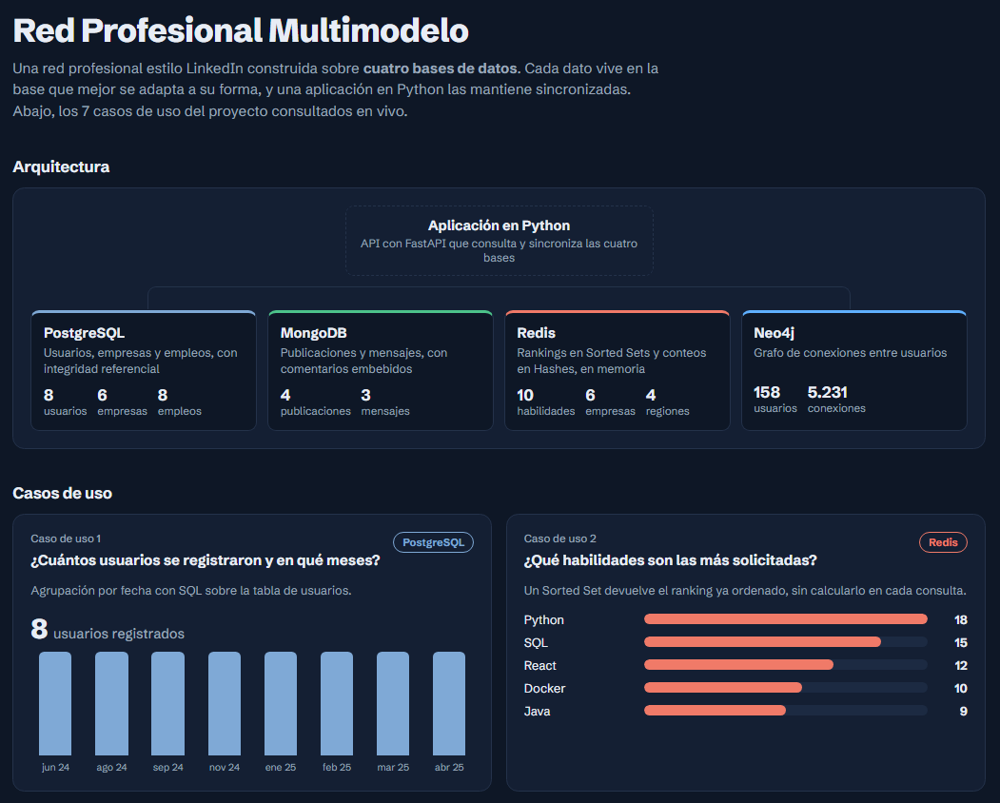
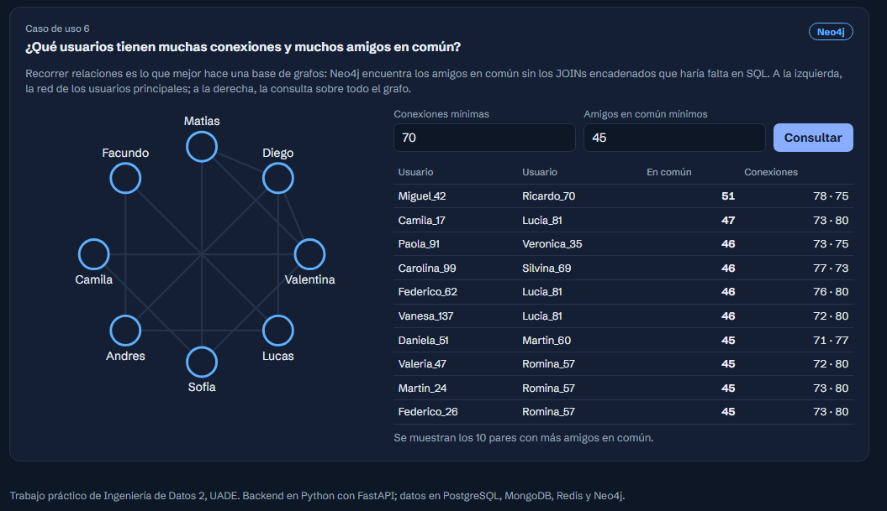

# Red Profesional Multimodelo

Sistema de gestión de datos para una red profesional estilo LinkedIn, construido sobre **cuatro bases de datos**: PostgreSQL, MongoDB, Redis y Neo4j. Cada dato se guarda en la base que mejor se adapta a su forma, y una aplicación en Python actúa como intermediaria y las mantiene sincronizadas.

> 🔗 **Demo online:** [TU-LINK.onrender.com](https://TU-LINK.onrender.com)
>
> La demo está en un servidor gratuito: si nadie la usó en un rato, la primera carga puede tardar alrededor de un minuto.
>
> Trabajo práctico de Ingeniería de Datos 2, UADE (2026).



## Por qué cuatro bases de datos

| Base | Qué guarda | Por qué esa base |
|---|---|---|
| **PostgreSQL** | Usuarios, empresas, empleos, postulaciones, experiencia, educación y habilidades | Datos de negocio con relaciones estructuradas e integridad referencial |
| **MongoDB** | Publicaciones y mensajes | Documentos flexibles, con los comentarios embebidos en cada publicación |
| **Redis** | Rankings de habilidades y empresas, conteos por región | Consultas muy rápidas en memoria: los Sorted Sets devuelven rankings ya ordenados |
| **Neo4j** | Red de conexiones entre usuarios | Recorrer relaciones, como buscar amigos en común, sin JOINs encadenados |

Las bases no se comunican entre sí. Python ejecuta las actualizaciones necesarias en cada una después de cada operación: por ejemplo, crear un usuario lo inserta en PostgreSQL, crea su nodo en Neo4j e incrementa el contador de su región en Redis.

## Casos de uso

| CU | Pregunta | Base |
|---|---|---|
| 1 | ¿Cuántos usuarios se registraron y en qué meses? | PostgreSQL |
| 2 | ¿Qué habilidades son las más solicitadas? | Redis |
| 3 | ¿Qué empresas están contratando más? | Redis |
| 4 | ¿Cuántas recomendaciones recibió un usuario? | MongoDB |
| 5 | ¿Cómo crece la red en cada región? | Redis |
| 6 | ¿Qué usuarios tienen muchas conexiones y muchos amigos en común? | Neo4j |
| 7 | ¿Qué habilidades se buscan en tecnología o en marketing? | Redis |



## Tecnologías

| Capa | Tecnología |
|---|---|
| Lenguaje | Python 3 |
| API web | FastAPI y Uvicorn |
| Bases de datos | PostgreSQL, MongoDB, Redis y Neo4j |
| Entorno local | Docker Compose, con interfaces web para cada base |
| Demo online | Render, con Neon (PostgreSQL), MongoDB Atlas, Upstash (Redis) y Neo4j AuraDB |

## Dos formas de usar el proyecto

El proyecto tiene dos interfaces que trabajan sobre el mismo modelo de datos:

- **Aplicación de consola** (`app/main.py`): menú interactivo para crear, modificar y eliminar todas las entidades, con sincronización entre las cuatro bases, y para ejecutar los casos de uso. Corre en local con Docker.
- **Panel web** (`web/`): API con FastAPI y una página que muestra los 7 casos de uso con gráficos. Es la versión publicada en la demo.

## Ejecutarlo en local con Docker

### Requisitos

- Docker Desktop
- Python 3 con las librerías: `pip install psycopg2-binary pymongo redis neo4j`

### Pasos

1. Cloná el repositorio y levantá los contenedores:
   ```bash
   git clone https://github.com/Matias-G-Gomez/Multidb-LinkedIn-UADE-Ingenieria-Datos-2.git
   cd Multidb-LinkedIn-UADE-Ingenieria-Datos-2
   docker compose up -d
   ```
2. Ejecutá la aplicación de consola:
   ```bash
   python app/main.py
   ```
   Se conecta a las cuatro bases y carga los datos iniciales si hace falta.
3. Opcional, para el caso de uso 6 con datos masivos: `python generar_datos_neo4j.py` crea 600 usuarios con más de 500 conexiones cada uno.

### Interfaces visuales de cada base

| Base | URL | Credenciales |
|---|---|---|
| Neo4j Browser | http://localhost:7474 | neo4j / secret123 |
| Mongo Express | http://localhost:8081 | sin credenciales |
| Redis Commander | http://localhost:8082 | sin credenciales |
| pgAdmin | http://localhost:8083 | admin@admin.com / secret123 |

## Ejecutar el panel web

1. Instalá las dependencias:
   ```bash
   cd web
   pip install -r requirements.txt
   ```
2. Copiá `.env.example` como `.env` y completá las direcciones de tus cuatro bases.
3. Cargá los datos de demostración y arrancá el servidor:
   ```bash
   python cargar_datos.py
   uvicorn app:app --reload
   ```
4. Abrí http://localhost:8000.

Para que responda rápido en servicios gratuitos, la demo usa un grafo de 158 usuarios con unas 5.200 conexiones. El caso de uso 6 permite ajustar los umbrales; en la versión local con `generar_datos_neo4j.py` se usan los umbrales originales del trabajo: más de 500 conexiones y 10 amigos en común.

## API del panel web

| Método | Endpoint | Descripción |
|---|---|---|
| GET | `/api/resumen` | Cantidad de datos en cada base |
| GET | `/api/cu1` | Usuarios registrados por mes (PostgreSQL) |
| GET | `/api/cu2` | Top 5 de habilidades (Redis) |
| GET | `/api/cu3` | Top 5 de empresas (Redis) |
| GET | `/api/cu4?id={idUsuario}` | Likes, comentarios y publicaciones de un usuario (MongoDB) |
| GET | `/api/cu5` | Usuarios por región (Redis) |
| GET | `/api/cu6?min_conexiones={n}&min_comun={n}` | Pares de usuarios con amigos en común (Neo4j) |
| GET | `/api/cu7` | Habilidades por sector (Redis) |

## Estructura del proyecto

```
├── docker-compose.yml        Las cuatro bases y sus interfaces visuales
├── generar_datos_neo4j.py    Datos masivos para el caso de uso 6
├── init-scripts/
│   └── postgres_init.sql     Tablas y datos de prueba de PostgreSQL
├── app/
│   └── main.py               Aplicación de consola con menú interactivo
└── web/
    ├── app.py                API con FastAPI
    ├── cargar_datos.py       Carga los datos en las bases en la nube
    ├── static/index.html     Panel web
    └── requirements.txt
```

## Autor

**Matías Germán Gómez**, junto al Grupo 2 de Ingeniería de Datos 2 (UADE, 2026).
[LinkedIn](https://www.linkedin.com/in/matias-german-gomez/) · [GitHub](https://github.com/Matias-G-Gomez) · [Portfolio](https://matias-gomez-black.vercel.app)
